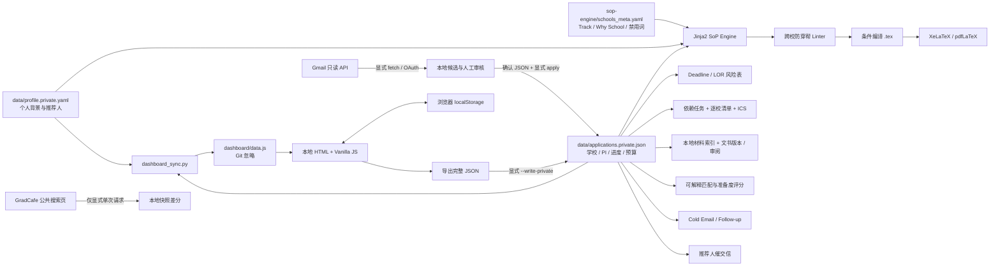

# GradPilot

**本地优先、Git 驱动的 Robotics / Embodied AI 博士申请与学术套磁全周期工作台。**  
**A local-first, Git-driven workspace for Robotics / Embodied AI Ph.D. applications, recommendation letters, outreach, SoP compilation, and admissions monitoring.**

> 目标画像：大连理工大学「大数据管理与应用」本科，GPA 3.4，Direct Ph.D.，目标 **2028 Fall**。研究定位为 Humanoid Whole-Body Loco-Manipulation、Motion Retargeting、RL、Sim-to-Real、Vision / Visuomotor Policy、Behavioral / Robot Foundation Models。硬件经验聚焦 Unitree G1/H2、Inspire 灵巧手与 Jetson Orin NX 闭环部署。
>
> **重要事实边界：** 种子库包含 19 个项目（15 个北美 + HKU / CUHK / NUS / NTU）。所有 2028 Fall 截止日和费用都是规划估计；PI 任职、招生状态与“近两年关键词”必须在发送邮件或提交申请前到官网复核。`Safe / Pivot` 只表示组合策略，绝不意味着保证录取。

---

## 1. 架构 / Architecture



- **Single Source of Truth：** `applications.private.json` 管理动态申请数据；`profile.private.yaml` 管理个人叙述、课程、科研与链接；`schools_meta.yaml` 管理文书专用内容。
- **双向看板：** Python 将 JSON/YAML 同步为 Git 忽略的 `dashboard/data.js`；浏览器自动保存到 `localStorage`，可导出 JSON，再由 CLI 校验并原子写回私有数据库。
- **无商业云数据库：** 无账号、无远程 API 后端、无 Node 构建链。Tailwind Play CDN 只提供可选工具类；本地 CSS/JS 已覆盖完整界面，CDN 不可用时核心看板仍可工作。
- **网络边界：** Python CLI 默认离线；只有显式运行 `monitor_gradcafe.py` 或 `import_gmail.py fetch` 才会主动访问外部站点。GradCafe 监测每次仅请求一个公开页面；Gmail 导入通过 Google OAuth 获得只读权限，仅在你执行 `fetch` 时读取匹配邮件。`--offline-messages` 完全不联网。邮件草稿脚本只写本地文件，Gmail 导入也绝不发送、删除或归档邮件。看板默认通过 Tailwind Play CDN 获取可选静态工具类，该请求不携带申请数据；删除 `index.html` 中的 CDN `<script>` 即可完全离线使用本地 CSS/JS。若处理高度敏感信息，建议采用这一纯离线配置，避免在含隐私页面中执行第三方脚本。

## 2. 目录 / Project Layout

```text
grad-pilot/
├── data/
│   ├── schema.json                 # JSON Schema + 自定义引用完整性检查
│   ├── profile.yaml                # 可公开的个人资料模板
│   └── applications.example.json   # 19 校 / PI / LOR / 预算示例库
├── dashboard/
│   ├── index.html                  # 可直接打开的工作台及可访问对话框
│   ├── styles.css                  # Mission Control 主题与响应式布局
│   ├── app.js                      # 状态、申请季、PI 雷达 / 对比、筛选、SVG 图表与导入导出
│   ├── modules.js                  # 无 DOM / 无网络的申请季、计划、三维评分、文书检查、diff、ICS 纯函数
│   └── data.js                     # 生成的同步数据，Git 忽略
├── sop-engine/
│   ├── main_sop.tex                # 跨专业叙事 + 真机壁垒 + Track 条件段落
│   ├── schools_meta.yaml           # 19 校元数据；Stanford / MIT ME 变体
│   └── build_sop.py                # 渲染、Linter、PDF 编译
├── scripts/
│   ├── common.py                   # 数据解析、校验、日期、原子写入
│   ├── dashboard_sync.py           # JSON/YAML ↔ 看板桥接
│   ├── check_deadlines.py          # Rich 倒计时与高危预警
│   ├── gen_cold_email.py           # 首封套磁与 Follow-up 草稿
│   ├── gen_lor_reminder.py         # 按推荐人汇总催交邮件
│   ├── import_gmail.py             # Gmail 只读取信、保守解析与确认写回
│   ├── gmail_review.py             # 无外部资源的本地邮件审核页
│   └── monitor_gradcafe.py         # 公共页面快照与新增行对比
├── tests/test_gradpilot.py         # 无网络单元测试与 CLI 集成测试
├── tests/test_gmail_import.py      # Gmail 解析、审核、指纹与写回离线测试
├── tests/fixtures/gmail_messages.json # 可人工阅读的模拟邮件，无真实隐私
├── tests/workspace_modules.test.cjs # 计划、评分、文书与 ICS 纯函数测试
├── tests/browser_smoke.mjs         # 真实 Chrome 全流程交互与持久化测试
├── TODO.md                         # 中优先级后续模块与外部服务边界
├── Makefile
├── pyproject.toml
└── requirements.txt
```

## 3. 快速上手 / Quick Start

### 3.1 安装 / Install

要求 Python 3.10+；推荐 `uv`。macOS / Ubuntu：

```bash
cd grad-pilot
uv sync
```

也可使用标准 pip：

```bash
python3 -m venv .venv
source .venv/bin/activate          # Windows PowerShell: .venv\Scripts\Activate.ps1
python -m pip install -r requirements.txt
```

生成 PDF 需要 TeX Live / MacTeX 中的 `xelatex`；没有 LaTeX 时仍可生成 `.tex` 并运行 Linter。Windows 下可全部使用 `uv run python ...`，不依赖 `make`。

### 3.2 建立私有数据 / Create Private Files

```bash
cp data/profile.yaml data/profile.private.yaml
cp data/applications.example.json data/applications.private.json
```

或让工具安全创建私有 JSON（已存在时会拒绝覆盖）：

```bash
uv run python scripts/dashboard_sync.py --init-private
```

编辑 `profile.private.yaml`：姓名、邮箱、真实课程、论文状态、个人贡献、可公开链接、推荐人。然后编辑 `applications.private.json`：真实 Track、官网截止日、推荐人分配、套磁状态。

**English:** The resolver prefers `applications.private.json` and `profile.private.yaml`, then falls back to public examples. Real personal data, generated dashboard data, drafts, PDFs, and monitoring snapshots are Git-ignored. Never commit a dashboard export containing private information.

### 3.3 打开看板 / Open Dashboard

```bash
make dashboard
# 等价 / equivalent:
uv run python scripts/dashboard_sync.py
# macOS: open dashboard/index.html
# Ubuntu: xdg-open dashboard/index.html
```

也可以直接双击 `dashboard/index.html`，再用「导入 JSON」选择 `data/applications.example.json` 或私有 JSON。没有 `data.js` 不影响手动导入。

看板包含：

1. **任务总览：** 下一截止日、LOR 完成率、触达率、逾期任务、费用、Tier / 状态 SVG 图表；每张图都有键盘 tooltip 和数据表。可置顶最多 4 个现有材料或文书作为“活文档”，显示版本与更新时间并直接进入编辑。
2. **全局申请季：** 按目标入学季生成科研证据、PI 发现、文书推荐信、网申、面试结果、入学行前 6 个阶段；展示当前阶段、真实工作区指标和下一步行动。只有显式点击才生成 / 补齐 6 个全局里程碑，阶段日期不会覆盖逐校截止日，时间段过去也不会被伪报为任务完成。
3. **规划时间线：** 每所学校首次载入时生成 7 个带依赖关系的规划任务，之后可修改或删除；支持自定义任务、申请季里程碑、循环依赖校验、逾期 / 阻塞状态和 ICS 日历导出。ICS 同时包含 Funding 与结果回复截止日。
4. **选校看板与逐校清单：** 搜索和筛选在学校表格、按阶段看板、月历之间共享；月历聚合申请 / Funding / 回复截止、未完成任务和推荐信缺口。每所学校有 9 项可自定义的默认清单，可关联材料、记录官方来源和核验状态。项目编辑包含 Funding 来源与考虑方式、导师联系政策、面试要求、Waitlisted、关闭原因和结果回复日期；`Ready to Apply` 由必需清单与推荐信完成度计算。综合工作分拆为研究匹配与背景、申请准备度、数据可信度三维展示，只衡量研究与工作区状态，不是录取概率，也不会自动修改 Tier。
5. **材料中心：** 管理成绩单、CV、论文、语言成绩等本地文件的路径、版本、适用学校与缺失 / 草稿 / 定稿 / 提交状态；逐校材料矩阵直接由现有清单与材料关联生成，可编辑要求或补建追踪项，不建立第二套材料数据库。文件内容不读取或上传，不伪造路径存在性检测。
6. **文书与审阅：** SoP、PS、PHS、CV、Research Statement 和项目短文；支持版本快照、逐行对比、历史恢复、字数与跨校静态检查、人工审阅意见和处理状态，以及置顶到总览继续写作。
7. **推荐信矩阵：** 每位推荐人一列；点击单元格循环 `未分配 → 待交 → 已交`，自动记录提交日期，并统计每位老师已交/待交/总分配。
8. **PI 雷达与套磁研究：** 跨学校搜索 PI / 论文 / 关键词，按地区、Track、招生、核验、Shortlist 和论文笔记筛选，每次显示 12 位并可继续加载；选择 2–4 位 PI 对比研究关键词、个人关键词命中、论文证据、匹配论证、任职招生和真实联系状态。Shortlist 及日期持久化到 JSON，对比选择仅保留在当前会话。联系记录继续保存本地邮件草稿、真实发送历史、多次询问通话、会议、Funding 线索与 Follow-up，并可手动把下一步行动转为规划任务；不自动发信。
9. **半 DIY 预算器：** 申请费、送分、其他、Fee waiver、考试、材料、润色/咨询、预留金及 USD/CNY 汇率。预算记录支出，Funding 字段单独记录经费来源和申请要求，二者不混为录取或资助承诺。
10. **资产与设置：** 公开链接人工核验；填写 GPA、科研年限、已核实成果数和研究关键词，供可解释评分使用；管理本地导入导出。
11. **Gmail 邮件导入（可选）：** 只读抓取匹配邮件，保守提取申请编号、提交 / 面试日期和申请结果；在完全本地的审核页逐项编辑、勾选并导出确认 JSON。只有终端显式执行 `apply --write-private` 才会更新私有数据库，并保留邮件 ID 导入记录。

案例库、模拟面试和本地问答知识库见 [TODO.md](TODO.md)，当前版本尚未实现；Offer 回复信息与全局行前里程碑已可记录，具体签证材料仍需按官方通知人工管理。

浏览器无法可靠跨域检测 YouTube / Bilibili / 学校页面是否公开可访问，因此看板**不会伪造在线检测成功**。请退出登录、换网络人工打开后再勾选。

### 3.4 看板写回 CLI / Browser-to-CLI Round Trip

```bash
# 1. 看板点击“导出备份”，得到 gradpilot-....json
# 2. 只校验，不写文件
uv run python scripts/dashboard_sync.py --import /path/to/gradpilot-export.json

# 3. 显式原子替换私有数据库
uv run python scripts/dashboard_sync.py --import /path/to/gradpilot-export.json --write-private

# 4. 再生成看板同步文件
uv run python scripts/dashboard_sync.py
```

浏览器修改优先保存在 `localStorage`，不会被磁盘文件悄悄覆盖。同步文件更新后，在「资产与设置」点击“重新载入 `dashboard/data.js`”才会替换工作区；替换前保留一个浏览器恢复点。

## 3.5 轻 DIY 模块使用边界 / Planning & Writing Modules

- **默认计划只初始化一次：** 每所学校首次载入生成 9 项清单和 7 个任务，并记录 `plan_version: 1`。之后删除或修改不会被页面刷新撤销。“补齐默认计划”只添加缺失的稳定 ID，不覆盖已有任务。全局申请季的 6 个里程碑只在你点击“生成 / 补齐”后创建，同样不覆盖已有任务。
- **任务是规划而不是官网事实：** 默认日期按截止日前 120 / 90 / 75 / 45 / 30 / 14 / 7 天计算；全局阶段日期按目标入学季计算。前置任务未完成时，后续任务不能标记完成；表单和 Python 校验都会拒绝循环依赖。ICS 包含活跃项目截止日、全局里程碑与未完成任务。
- **Shortlist 不是录取分层：** PI 的 `shortlisted` / `shortlisted_on` 只表示你的优先研究候选，不改变学校 Tier，不代表招生或录取机会。未选择 Shortlist 的旧 JSON 无需迁移。
- **材料只存索引：** `documents` 保存相对或绝对路径、版本和状态，PDF / DOCX 本身不进入 JSON 或 localStorage。路径存在性、文件内容与公开可访问性必须人工检查。
- **评分不是录取率：** 15 个分项保持原有 100 分综合工作分口径，同时拆为研究匹配与背景（60%）、申请准备度（20%）、数据可信度（20%）三维展示。覆盖 PI 匹配、关键词重合、论文阅读、个人资料、公开证据、官网核验、推荐信、材料、清单和真实套磁进展。缺资料会降低信息完整度或可信度得分，不等于录取机会低；系统不会自动给出 Reach / Match / Safe 或概率。PI 对比不合成新分数，逐项展示证据和未知项。
- **文书定稿有本地门禁：** 超字数、占位符、其他学校名称 / 别名和错误入学季会阻止 `final` / `submitted`；证据与项目适配提示需要人工判断。每次正文变化保存一个版本，恢复历史也会生成新版本。
- **论文笔记进入邮件有额外条件：** 只有 PI 标记 `verified_official`，且论文标题和阅读笔记均非空时，CLI 才会把该论文写入套磁正文。普通关键词仍只作初筛，不能伪装成已精读论文。

## 4. 常用命令 / Command Reference

| 命令 | 功能 |
|---|---|
| `make validate` | JSON Schema、日期、ID 唯一性与推荐人引用校验 |
| `make check` | 数据校验 + Deadline 风险表 + 全部 SoP Linter |
| `make deadlines` | Rich 彩色倒计时、LOR 缺口、套磁触达与高危预警 |
| `make sop` | 全部学校生成 TeX；有 XeLaTeX 时生成 PDF |
| `make sop-tex` | 全部学校只生成 TeX |
| `make email PI="Sergey Levine" SCHOOL=berkeley` | 生成指定 PI 的 Markdown + HTML 首封草稿 |
| `make lor RECOMMENDER=dut-advisor` | 生成该推荐人的催交邮件 |
| `make monitor` | 单次抓取 robotics 公共搜索并保存本地快照 |
| `make test` | 无网络 Python 测试 |
| `make module-test` | 计划、评分、文书与 ICS 纯函数测试 |
| `make browser-test` | 纯函数测试 + 真实 Chrome 全流程测试 |

无 `make` 时直接使用以下命令。

### Deadline / 风险预警

```bash
uv run python scripts/check_deadlines.py
uv run python scripts/check_deadlines.py --days 45
uv run python scripts/check_deadlines.py --today 2027-11-15 --json
```

风险包括：已过截止日、7/30 天窗口、推荐人未分配、已提交但推荐信待交、尚未套磁。`~` 表示规划日期未核验。`--json` 便于接入自己的本地自动化。

### Cold Email / Follow-up

```bash
uv run python scripts/gen_cold_email.py \
  --school berkeley --pi sergey-levine --format both

uv run python scripts/gen_cold_email.py \
  --school berkeley --pi sergey-levine --follow-up

# 仅为某校全部 PI 生成草稿；不会发信
uv run python scripts/gen_cold_email.py --school cmu --all
```

默认主题：

```text
Prospective Ph.D. Student 2028 Fall - Humanoid Loco-Manipulation & Sim-to-Real (Your Name)
```

需求示例中的 `2027 Fall` 与本项目目标 `2028 Fall` 不一致，因此入学季由 `profile.yaml` / `--term` 控制，默认 2028 Fall。首段直接说明 G1/H2 + Inspire 全身灵巧操作闭环，并包含主页、论文 PDF、真机 Demo 链接。`recent_work_keywords` 是初筛线索，不应伪装成已经精读的论文；只有 PI 已官网核验且具体论文标题、阅读笔记完整时，论文内容才会进入正文。每份草稿附内部发送前检查清单；看板中的邮件版本与发送历史只由你显式记录，工具绝不自动发信。

### 推荐人催交 / LOR Reminders

```bash
uv run python scripts/gen_lor_reminder.py --recommender dut-advisor
uv run python scripts/gen_lor_reminder.py --all --due-within 30
```

按推荐人视角汇总未提交学校、项目、截止日和申请链接。发送前将申请入口替换为实际推荐信 portal 链接，并核对官网时间；草稿不会自动发送。

### GradCafe 快照 / Monitoring

```bash
uv run python scripts/monitor_gradcafe.py --query robotics
uv run python scripts/monitor_gradcafe.py --query "computer science" --show-all
uv run python scripts/monitor_gradcafe.py --offline-html saved-page.html --query test
```

首次运行建立 baseline；后续按整行内容哈希识别新增结果，快照位于 `.state/`。站点结构变化可能导致通用表格解析器无结果，工具会明确警告，不会把无结果解释为“没有新动态”。每次命令仅发起一次公开请求，不绕过登录或访问限制；用户应自行确认网站条款与 robots 政策。GradCafe 内容属于未经核验的众包信息。

### Gmail 只读导入 / Reviewed Gmail Import

该模块把 Gmail 作为**可选的候选信息来源**，不会用邮件解析结果直接覆盖看板：

```text
只读 Gmail → 本地规则解析 → 静态 HTML 人工审核 → 导出确认 JSON
           → apply 预览 / 显式写回 → dashboard_sync.py
```

**1. 先运行无网络演示：**

```bash
uv run python scripts/import_gmail.py fetch \
  --offline-messages tests/fixtures/gmail_messages.json \
  --data data/applications.example.json \
  --output-dir out/gmail-import-demo
```

打开输出目录中的 `*.review.html`，即可体验学校匹配、字段编辑、逐项勾选和确认 JSON 导出。演示模式不需要 Google 凭据，也不访问网络。

**2. 配置真实 Gmail：** 按 [credentials/README.md](credentials/README.md) 创建 Google Cloud 桌面应用 OAuth 客户端，将文件保存为 `credentials/gmail-oauth.json`。首次运行会打开浏览器授权；只申请 `gmail.readonly`，令牌缓存到 Git 忽略的 `.state/gmail-token.json`。

```bash
# 安装新增依赖：uv sync，或 python -m pip install -r requirements.txt
# 默认最多读取 50 封匹配邮件；上限 200。不会自动修改申请 JSON。
uv run python scripts/import_gmail.py fetch

# 自定义 Gmail 查询
uv run python scripts/import_gmail.py fetch --max-results 80 \
  --query 'newer_than:2y {subject:PhD subject:application subject:interview}'
```

**3. 审核并导出：** 打开生成的 `out/gmail-import/*.review.html`，对照 Gmail 原文选择学校，勾选需要导入的邮件和字段，再下载确认 JSON。页面无 CDN、无远程脚本，邮件正文不写入候选文件；仅保留主题、发件人、摘要、提取字段与原文链接。默认不勾选任何邮件，高置信项也需要人工确认。

**4. 预览后写回：**

```bash
# 只预览，不写文件
uv run python scripts/import_gmail.py apply "下载的确认JSON路径"

# 原子更新 data/applications.private.json；拒绝写入公共 example
uv run python scripts/import_gmail.py apply "下载的确认JSON路径" --write-private

# 重新生成看板同步文件；浏览器修改仍需按 3.4 节导出并写回
uv run python scripts/dashboard_sync.py
```

如果尚无私有数据库，先运行 `uv run python scripts/dashboard_sync.py --init-private`。审核文件包含生成时的数据库 SHA-256；此后磁盘 JSON 若有任何变化，`apply` 会拒绝覆盖，必须重新抓取审核。多封确认邮件按邮件日期从早到晚应用；改为非 `Closed` 状态时，会同步清除旧的关闭原因。

当前保守英文规则支持：

- `Application ID / Reference ID / Confirmation Number` 等申请编号，保留连字符；
- 明确的提交日期、面试日期；不猜测 `02/03/2028` 之类有歧义的数字日期；
- `Submitted / Under Review → Submitted`，面试邀请 → `Interview`，Waitlist → `Waitlisted`，明确录取 → `Admitted`，明确拒信 → `Closed + rejected`；
- 学校名称 / 别名和已有申请编号匹配；多个学校或编号冲突时不自动选择，旧邮件可能造成的状态回退会显示警告。

它不会保证理解所有学校模板，也不处理其他语言或图片 / 附件中的结果。未识别内容可留在审核页手动填写。确认记录保存在私有 JSON 的可选 `gmail_imports` 数组中，用于标记已处理邮件；学校记录新增可选 `application_id`、`submission_date`、`interview_date`，旧 JSON 无需迁移。

## 5. SoP 多校条件编译 / SoP Engine

```bash
# 默认 CS / Robotics Track
uv run python sop-engine/build_sop.py --school berkeley
uv run python sop-engine/build_sop.py --school cmu --no-pdf

# 审核过的 ME 变体
uv run python sop-engine/build_sop.py --school stanford --track ME
uv run python sop-engine/build_sop.py --school mit --track ME --engine xelatex

# 全部静态检查；示例姓名仅警告，严格模式将警告提升为失败
uv run python sop-engine/build_sop.py --all --lint-only
uv run python sop-engine/build_sop.py --all --strict --no-pdf
```

- **Pivot Narrative：** 将大数据管理背景真实转化为数学建模、统计决策、优化、MDP 与大规模数据管线能力，再衔接海量仿真 RL 和 BFM；不伪装成 CS 学位。
- **硬件壁垒：** 强调 G1/H2 + Inspire、ROS 2、ONNX Runtime、Jetson Orin NX 上的 observation-to-action 排查与真实接触问题。
- **CS：** 大规模 RL、表征学习、Visuomotor Policy、跨 embodiment 泛化与评测。
- **Robotics：** 全身动力学、接触、感知、机载系统与硬件协同。
- **ME：** 动力学、稳定性、接触力学、模型学习与实验验证。
- **Linter：** 其他学校名/别名、跨校禁用词、错误入学季、遗留 Jinja 语法为错误；姓名/URL 占位符和泛化项目名为警告。`--strict` 可用于最终提交门禁。

输出在 `dist/sop/`。当前母版约 1,200 英文词，是内容完整的母版而非所有学校的最终字数版本；必须根据项目字数限制删减。所有论文、指标、课程与个人贡献都应只写可证明的事实。

## 6. 数据与 Git 隐私规则 / Data Contract

| 文件 | 用途 | Git |
|---|---|---|
| `applications.example.json` | 公共示例与学校/PI 种子 | 可提交 |
| `profile.yaml` | 公共个人资料模板 | 可提交 |
| `applications.private.json` | 真实动态数据库 | 忽略 |
| `profile.private.yaml` | 真实个人资料 | 忽略 |
| `applications.json` | 兼容的私有工作文件 | 忽略 |
| `dashboard/data.js` | 可能含隐私的同步产物 | 忽略 |
| `dist/`、`out/`、`.state/` | PDF、邮件草稿、监测快照 | 忽略 |

Schema 使用 Draft 2020-12；除 JSON Schema 外，`common.py` 还检查学校/PI/推荐人 ID 重复、推荐信引用完整性、交流历史 ID、网申申请编号唯一性和置顶引用。`documents`、`tasks`、`essays`、逐校 `application_checklist`、学校 `funding` / `application_policy` / `decision` 均为可选集合或对象，旧版 JSON 无需迁移；`settings.pinned_items` 使用 `document:<id>` / `essay:<id>` 引用现有工作稿。`contact.history` 在同一时间线上保存邮件与详细交流记录。导出时会校验学校、材料、任务依赖、文书引用和置顶引用，并拒绝任务依赖环。日期使用带 UTC offset 的 ISO 8601，例如 `2027-12-08T23:59:00-08:00`；显示时区默认 `Asia/Shanghai`。Gmail 模块新增的三个学校字段与 `gmail_imports` 审核记录同样向后兼容，并随私有 JSON 一起备份。

## 7. 申请策略使用建议 / Strategy Notes

- **Direct Ph.D. 没有真正保底。** 用 PI 匹配度、招生可能性、 funding route 与院系审查综合分层，不只看综合排名。
- **Track 是独立申请策略。** CS 强调学习/表征/视觉；Robotics 强调系统与动力学；ECE 可强调控制、嵌入式与感知；ME 强调动力学、接触与实验。复制看板项目为独立 Track，不要只替换 SoP 校名。
- **跨专业叙事不要过度补偿。** GPA 3.4 不需要在 SoP 中主动反复强调；用科研问题、真实个人贡献、可复现实验与强推荐信证明博士研究准备度。
- **2026.11–2027.06：** 固化论文/预印本、代码、未剪辑真机视频和英文项目页；确认课程与科研证据。
- **2027.07–2027.10：** 分批个性化套磁，记录真实发送日期；默认 12 天后 Follow-up，避免向同组多位 PI 群发同质内容。
- **2027.11–2027.12：** 以官网为准锁定截止日，完成推荐人分配与催交；逐校运行严格 Linter 并人工通读。
- **2028.01–2028.04：** 记录面试、回复与结果，GradCafe 仅作噪声较高的参考。

## 8. 测试与局限 / Tests and Limitations

```bash
python -m unittest discover -s tests -v
node --check dashboard/app.js
node --test tests/workspace_modules.test.cjs
node tests/browser_smoke.mjs   # 需 Node 22+；可用 CHROME_PATH 指定 Chrome / Chromium
```

也可运行 `make test`、`make module-test` 和 `make browser-test`。看板运行本身不需要 Node；Node 仅用于语法、纯函数与浏览器测试。

测试覆盖：19 校数据契约、推荐人引用、材料 / 文书 / 学校交叉引用、任务依赖环、倒计时、全部 SoP 渲染与 Linter、CS/Robotics/ME 条件段落、跨校名称注入、套磁主题 / 链接 / 硬件首段、已核验论文个性化、CLI 双格式输出、GradCafe 离线解析、默认计划、评分边界、文书静态检查与 ICS。新增覆盖 Funding / 政策 / 结果字段、Waitlisted、置顶引用、多段交流历史、Funding 与回复截止 ICS，以及真实 Chrome 中的表格 / 阶段看板 / 月历、材料矩阵、置顶和“交流转任务”。Gmail 测试覆盖嵌套 MIME / HTML 清理、学校歧义、状态回退、审核 HTML 注入防护、数据库指纹、字段白名单和离线 CLI 写回，全程不需要 Google 凭据。Python 测试不访问网络；浏览器冒烟测试使用沙箱中的无头 Chrome 验证材料、任务阻塞、逐校清单、文书版本 / 审阅、邮件草稿和 localStorage 持久化，并额外用 Python 校验浏览器导出的完整 JSON。Tailwind CDN 是否可达不影响核心断言。

**English summary:** GradPilot is a local workflow, not an admissions oracle. It does not guarantee admission, verify faculty availability in real time, send emails, submit applications, or bypass website restrictions. Treat every generated SoP and email as a draft requiring factual review, genuine PI reading, and program-specific editing.
